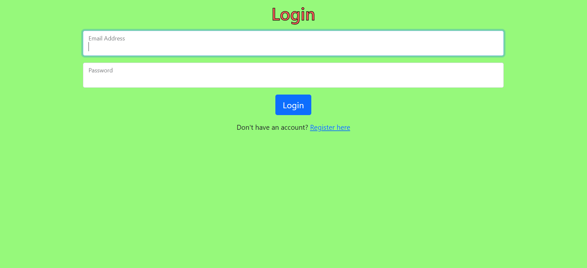

# Mail

A single-page email client built with **Django** and **JavaScript**. Users can register, log in, and send, receive, read, archive, and reply to emails, all without page reloads. (Project 3 of CS50's Web Programming with Python and JavaScript.)

## Features

- **Inbox, Sent, and Archive** mailboxes, loaded dynamically via the API
- **Compose** new emails with recipients, subject, and body
- **Read** an email; it is automatically marked as read
- **Archive / Unarchive** emails from the inbox or archive
- **Reply** with recipients, subject (`Re: ...`), and quoted body pre-filled
- Unread emails shown with a white background, read emails with gray

## Tech Stack

- Python 3 / Django
- JavaScript (vanilla, fetch API)
- HTML / CSS (Bootstrap)
- SQLite (default Django database)

## Project Structure

```
Mail/
├── manage.py
├── project3/          # Django project settings and URL config
│   ├── settings.py
│   ├── urls.py
│   ├── asgi.py
│   └── wsgi.py
└── mail/              # Main application
    ├── migrations/
    ├── static/mail/   # JavaScript and CSS
    ├── templates/mail/# HTML templates
    ├── admin.py
    ├── models.py
    ├── urls.py
    └── views.py
```

## Getting Started

1. **Clone the repository**
   ```bash
   git clone https://github.com/hoomanv3xo/Mail.git
   cd Mail
   ```

2. **Create and activate a virtual environment** (recommended)
   ```bash
   python -m venv venv
   source venv/bin/activate      # Windows: venv\Scripts\activate
   ```

3. **Install dependencies**
   ```bash
   pip install django
   ```

4. **Apply migrations**
   ```bash
   python manage.py makemigrations mail
   python manage.py migrate
   ```

5. **Run the development server**
   ```bash
   python manage.py runserver
   ```

6. Open **http://127.0.0.1:8000/** in your browser, register an account, and start sending mail. To test, register two accounts and send emails between them.

## API Routes

| Method | Route                  | Description                                  |
|--------|------------------------|----------------------------------------------|
| POST   | `/emails`              | Send a new email                             |
| GET    | `/emails/<mailbox>`    | List emails in `inbox`, `sent`, or `archive` |
| GET    | `/emails/<int:id>`     | Get a single email                           |
| PUT    | `/emails/<int:id>`     | Mark as read/unread or archived/unarchived   |

## Notes

- Emails are stored only in the local database; nothing is sent over the internet.
- This project is for educational purposes. Do not use the default `SECRET_KEY` or `DEBUG = True` in production.

## Author

[hoomanv3xo](https://github.com/hoomanv3xo)
